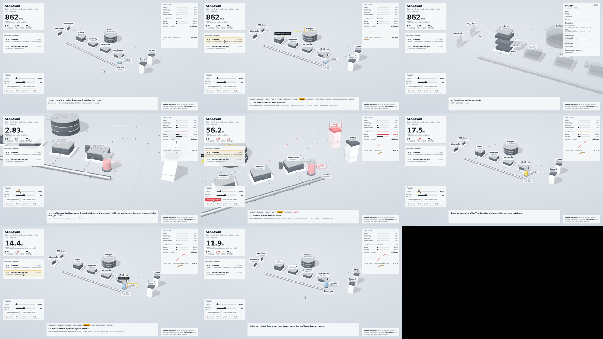

# xray

**Turn any codebase into a live 3D system you can watch run.**

xray is a [Claude Code](https://claude.com/claude-code) skill. Point it at a repo and it builds a 3D model of the running system: services and modules as machines, queues as glass tanks, an event bus, databases, and outside services (Stripe, OpenAI, AWS…) beyond a wall. Then you can:

- **follow one real request** hop by hop through every service, query, event, job and API call
- **push the traffic** until a queue backs up and turns red
- **take an outside service down** and watch timeouts and retries spread through the system
- **click any block** to open it and see its parts, endpoints, events and workers

Every block, pipe and arrow points at the file and line it came from. Numbers that are guesses are labelled as guesses.



Open [`docs/demo.html`](docs/demo.html) in a browser to drive the example yourself. It's one offline file, built from [`examples/nest-shop`](examples/nest-shop).

## Install

```bash
git clone https://github.com/niyatinehal/xray ~/.claude/skills/xray
cd ~/.claude/skills/xray && npm install && npx playwright install chromium
```

You also need Node.js 20+, plus `ffmpeg` if you want the video. Then open Claude Code in any repo and say:

> xray this codebase

Claude scans the code, reads each traced step to confirm it, names the flows in plain words, builds the page and checks it before showing you.

## What it reads

| | Automatically |
|---|---|
| **Frameworks** | Express, Koa, Fastify, Hono, NestJS, Next.js (API routes, app router, server actions); FastAPI, Flask, Django |
| **Data** | Prisma, Drizzle, TypeORM, Mongoose, Sequelize, Knex, Supabase, raw SQL, Redis; SQLAlchemy, Django ORM, pymongo |
| **Events and jobs** | event emitters, NestJS events and microservices, Kafka, Redis pub/sub, RabbitMQ; BullMQ, Bull, Celery, Dramatiq, RQ |
| **Outside services** | 40+ SDKs (Stripe, OpenAI, Anthropic, AWS, Twilio, Resend, …) and plain HTTP calls to other hosts |
| **Repo shapes** | monorepos (`services/*`, `apps/*`, …) and single apps, split into their modules |

**Any other language** (Go, Java, Ruby, PHP, C#, Rust…): Claude reads the code and writes the map by hand in the same format. The build and checks work the same way. See [`examples/go-manual`](examples/go-manual) and [`references/manual.md`](references/manual.md).

## Outputs

- `xray-out/xray.html`: one offline page (~700 KB) with a self-running tour. Any click hands control to you, and 25 s of idle brings the tour back.
- `xray-out/xray.mp4`: the tour as a 1080p video, rendered frame by frame so nothing drops.
- `xray-out/contact-sheet.png`: a still from every beat of the tour, for review.

## Running the steps yourself

```bash
X=~/.claude/skills/xray/scripts
node $X/scan.mjs .                      # writes xray-out/system.json
node $X/build.mjs xray-out              # first run writes xray-out/xray.config.json; edit it, run again
node $X/check.mjs xray-out --repo .     # verifies evidence, renders stills, flags problems (--quick to iterate)
node $X/record.mjs xray-out             # optional MP4
```

The formats are in [`references/schema.md`](references/schema.md).

## Honest limits

- **Structure is read from code; timings are estimated.** Latencies, traffic and capacity are guesses unless you supply real numbers, and the queue model is deliberately simple. Worker concurrency, timeouts and retry counts are read from code where they exist. Treat the page as an explanation of how the system works, not as a load test.
- **The scanner matches code patterns; it doesn't fully parse the language.** It misses calls made through unusual indirection: some dependency-injection containers, generated clients, calls decided at runtime. The skill has Claude read the code behind every traced step before drawing, and [`references/adapting.md`](references/adapting.md) explains how to extend the scanner.
- **The tests use example repos written for this project.** Real codebases will find gaps. Please open an issue with what it missed.
- **Large systems get crowded.** Beyond about 15–20 services, labels start competing for space.
- **Privacy.** It never opens `.env*` files and blanks secret-looking strings, but the output still shows the shape of your system. Set `"redact": true` before sharing: it hides file paths and code lines. Service and vendor names still show.

## Development

```bash
npm install
npm test          # scanner and build regression tests against examples/
```

The examples are small but realistic codebases. Each test pins down the flow a person reading that code would trace. If you teach the scanner a new pattern, add an example and a test.

## Licence

MIT. three.js (MIT) is bundled into the generated page.
